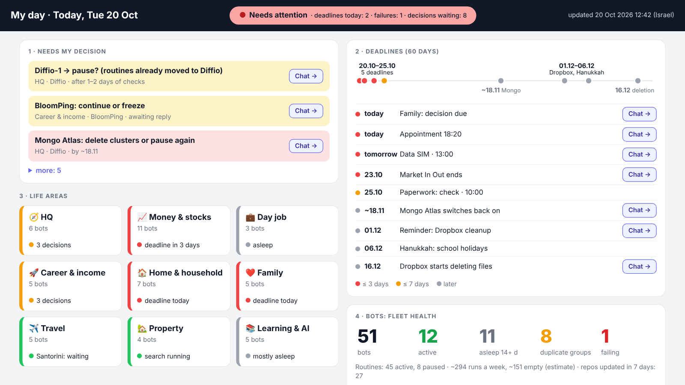
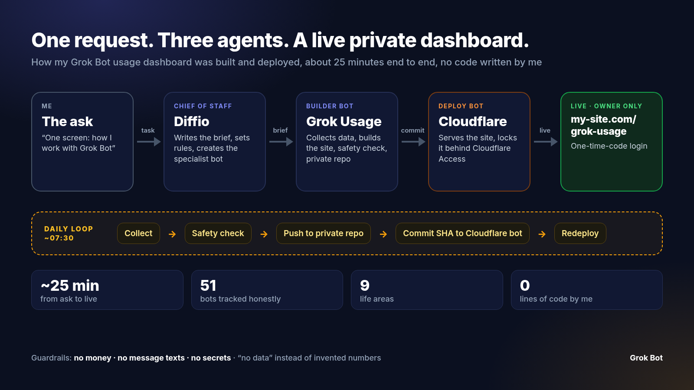
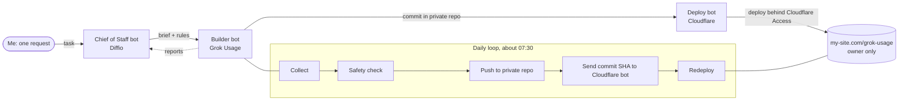
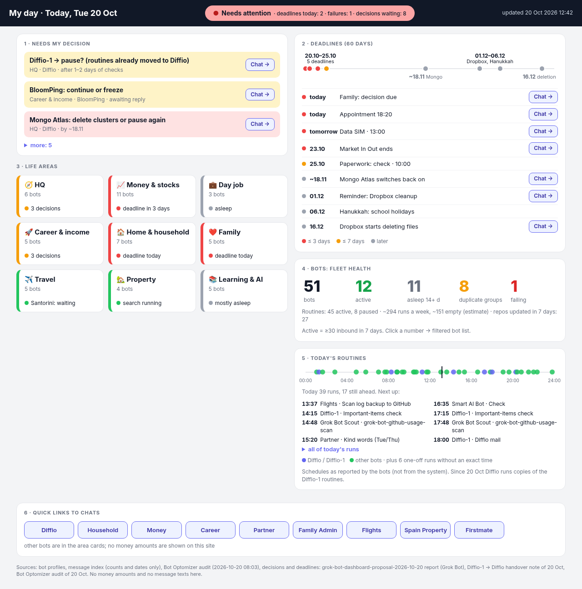

# Grok Bot usage dashboard, built by a chain of agents

A private, one-screen dashboard that shows how I use Grok Bot: what needs my decision, upcoming deadlines, my bots grouped into 9 life areas, fleet health and today's routines.

**What you get:** one screen that answers "how am I doing with my bots?" in 10 seconds.

English copy of the real dashboard on day one: real counts and layout, people's names replaced with role names.

I didn't write any code. I sent one request to my **chief-of-staff bot**. It briefed a **builder bot**, and the builder handed the deploy to my **Cloudflare bot**. About 25 minutes later the site was live behind Cloudflare Access, and it now refreshes itself every morning.

This repo has the story, the brief and the guardrails, plus the steps to set up the same chain with your own Grok Bot. The dashboard's code and data stay in a separate **private** repo and are not published here.

[▶ Watch the 30-second explainer (no sound, subtitles)](assets/grok-usage-explainer-1080x1920.mp4)

---

## The chain

| Agent | Role in this build |
|---|---|
| **Chief of Staff** (Diffio) | Takes my request, writes the brief and the rules, creates the specialist bot and makes the follow-up decisions |
| **Grok Usage** (builder) | Collects the data, builds a static site (HTML/CSS/JS plus one JSON file), runs a safety check and commits to a private repo |
| **Cloudflare** (deploy) | Serves the site from my existing Cloudflare setup and adds Cloudflare Access (one-time-code login, owner only). It also checks the files and confirms there are no JavaScript errors. |

The builder and the deploy bot work out the details between themselves. I don't pass messages between them.

### Timeline (2026-10-20, Israel time)

| Time | What happened |
|---|---|
| ~12:34 | Chief of Staff creates the Grok Usage bot |
| ~12:45 | v1 is built and pushed to the private repo |
| ~13:00 | Live behind Cloudflare Access |
| every day ~07:30 | collect → safety check → push → redeploy |

---

## The brief

The full brief and the follow-up decisions are in [`instructions.md`](instructions.md). In short:

- **One screen, 10 seconds:** status light, up to 3 decisions waiting, deadlines timeline, 9 life-area cards with their bots, fleet health (active / sleeping / duplicates), today's routines and buttons that open each bot's chat.
- **Private repo** for the code and data. Never public.
- **Deploy with the Cloudflare bot**, behind Cloudflare Access, for the owner only.
- **Refresh once a day** through the bot's own routine.
- **Order of work:** static prototype with real data → deploy behind Access → daily auto-refresh.

## Guardrails

These were written into the brief before any code existed:

- **No financial data:** no amounts, balances or cards.
- **No message texts:** the collector reads message *counts and dates* only.
- **No secrets:** no tokens, keys or email addresses on the site or in the repo.
- **Family and health:** short deadline names only, with no medical details.
- **Honest numbers:** missing data is shown as "no data" and numbers are never invented. All bots are listed, and sleeping bots and duplicates are marked.
- **Safety check on every update:** a script scans the generated data for currency amounts, secrets, emails and health terms. If it finds any, it stops the push.
- **Private by default:** private repo, and the site sits behind Cloudflare Access.

## Screenshots

The screenshots are an English copy of the real dashboard. They use the real counts and the real layout, with people's names replaced by neutral role names.

**Full page** (adds today's routines on a 24-hour timeline and quick buttons into each bot's chat):

What it showed on day one: **51 bots**, **12 active**, **11 asleep for 14+ days**, **8 duplicate groups**, **1 broken routine**, about **294 routine runs a week** (an estimated 151 of them find nothing), across **9 life areas**.

---

## Set up the same chain with your own Grok Bot

You need Grok Bot, a GitHub account (for a private repo) and a Cloudflare account with a domain.

1. **Have one chief-of-staff bot.** Give it the job of taking your requests, splitting them into tasks, creating specialist bots and collecting their reports.
2. **Have a deploy bot.** This is a bot connected to your Cloudflare account that owns your domains and deployments.
3. **Send one request to the chief of staff.** For example:
   > Build me a private dashboard at my-site.com/grok-usage: one screen where I see in 10 seconds how I work with Grok Bot. Show a status light, up to 3 decisions waiting for me, deadlines, my bots grouped by life area, fleet health (active / sleeping / duplicates), today's routines and links to each bot's chat. Create a dedicated bot for it. Code and data go in a private GitHub repo. Deploy with my Cloudflare bot behind Cloudflare Access, for me only. No money, no message texts, no secrets. If data is missing, write "no data". Refresh once a day.
4. **Let it write the brief.** A good chief of staff turns that into a scoped brief like [`instructions.md`](instructions.md), with explicit FORBIDDEN rules and an order of work.
5. **Approve the deploy.** The builder bot and the deploy bot coordinate directly. You approve the steps your setup asks you to confirm and then open the link.
6. **Check the guardrails.** Open the site and look for anything you wouldn't want on screen. Ask the builder to add those terms to its safety check.
7. **Turn on the daily routine.** collect → safety check → push → tell the deploy bot the commit → redeploy.

Tips:

- Keep the dashboard data to **counts, dates and short labels**. That makes the safety check simple and the page safe to glance at.
- Ask for "no data" instead of estimates. A missing number is more useful than a made-up one.
- Let the dashboard list duplicate and sleeping bots. It's the quickest way to see which bots to clean up.

---

## Assets in this repo

| File | What it is |
|---|---|
| `assets/agent-chain-1600x900.png` | Chain diagram (16:9) |
| `assets/dashboard-en-top-1600x900.png` | Dashboard, top of the page (16:9) |
| `assets/dashboard-en-full-1280.png` | Dashboard, full page (1280 px wide) |
| `assets/dashboard-en-allbots-1280.png` | Dashboard with the full bot list open (optional) |
| `assets/grok-usage-explainer-1080x1920.mp4` | 30-second vertical explainer, no sound |
| `instructions.md` | The brief and the decisions |

Built with Grok Bot. The dashboard code is private. This repo only documents the approach.
